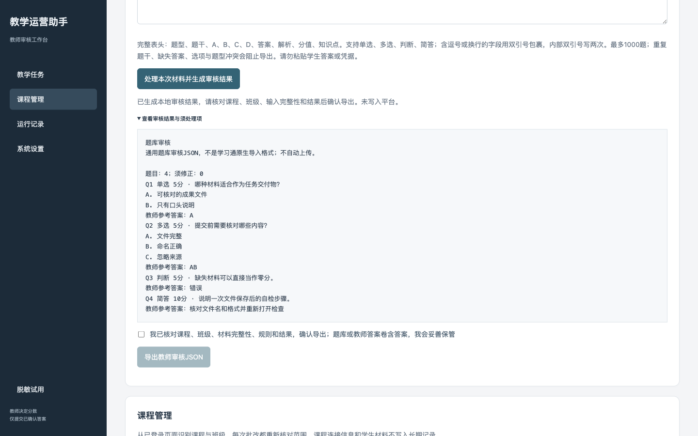
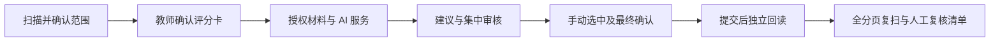

  

**给学习通教师的一套本机辅助工具：扫描待批、读取材料、生成评分建议、集中审核与独立回读。** 教师决定标准和最终成绩，工具负责减少重复操作。

[下载 v0.41.4](https://github.com/nohookcarey/Autochaoxing/releases/tag/v0.41.4) · [安装与第一次使用](INSTALL.md) · [功能范围](#能做什么) · [反馈问题](https://github.com/nohookcarey/Autochaoxing/issues/new/choose) · [参与贡献](CONTRIBUTING.md)

> 独立社区项目，非超星/学习通官方产品。仅在教师本人权限、学校和平台允许的范围内使用。[使用边界与版权](RIGHTS.md) · [隐私政策](PRIVACY.md) · [安全报告](SECURITY.md)

## 三分钟开始

1. 下载 Release 的扩展 ZIP，完整解压。
2. Chrome / Edge 扩展管理页打开“开发者模式”，选择“加载已解压的扩展程序”，选中含 manifest.json 的文件夹。
3. 固定扩展图标，先开启“脱敏演示”，再登录自己的学习通课程进行只读检测。

普通使用无需写脚本、购买域名或部署服务器。AI 按需自配；没有内置免费 API。当前手动安装与更新，尚无浏览器商店一键安装。

## 能做什么

| 教师任务 | 提供的帮助 | 当前边界 |
|---|---|---|
| 作业批改 | 待批扫描、评分卡、分项建议、集中审核、选中提交、逐份核验 | 普通作业已有本机真实提交与回读证据；只补待批、保留旧成绩 |
| 附件阅读 | 网页文字、文本、DOCX、PDF、图片，受限 ZIP/XLSX 静态读取 | 扫描件需图像模型；超限、未支持结构或读取不完整转人工，不运行学生代码 |
| 章节测试 | 工作台范围识别、评分与总分核验流程 | 原生真实提交、多题及不同学校页面仍待现场验收 |
| 日常教学运营 | 截止时间清单、单条改期预演与回读、课程/章节/成绩概览、签到异常和表格辅助 | 不支持页面返回“未获取”；部分快捷扫描需已验证本机配置 |
| 作业设计与讲评 | 任务说明检查、评分卡库、校准、基于已审核分项的讲评草稿 | 教师复核，不自动发布，不推断教学效果 |
| 命题与课堂准备 | 题库审核、按题型组卷、学生卷/答案卷导出、匿名分组与选人 | 本机工具，不等于已接通学习通题库导入或原生发布 |
| 学情与记录 | 得分分布、异常清单、脱敏报告、权重试算、课程文件清单 | 区分已确认与已核验；试算不回写成绩 |

完整条目见[教师端场景覆盖矩阵](docs/teacher-assistant/教师端场景覆盖矩阵_v0.41.0.md)。“已实现”与“真实平台验收”分开记录，不宣称覆盖学习通所有场景。

## 界面预览

以下是 v0.41.0 用教师自编模拟材料取得的本机界面证据，展示题库审核；不是学生数据，也不是学习通原生发布成功截图。

## 一次可靠批改怎样完成

- 默认不勾选任何答案；默认只提交分数，评语另选。
- 范围、答案或评分卡改变，旧建议失效；材料不完整、分项缺失、总分不一致时禁止提交。
- “未获取”不等于“确认没有待批”；结果不确定时先核对平台，禁止盲目重提。

## 隐私与安全

答案和草稿仅在本次浏览器会话处理；密钥默认会话使用，主动记住时存入本机扩展存储，不承诺加密。长期历史最多100条脱敏摘要。

AI 会接收教师授权的必要材料。文本脱敏有局限，图片/附件可能仍含身份信息，请先检查。本机 Codex 桥接仍使用在线服务，不是离线模型。详见[隐私政策](PRIVACY.md)。

v0.41.4 增加网关来源/会话校验、附件流式限额、全仓隐私门禁及安装包白名单；移除当前公开文件的固定业务标识，停用历史定向强制写入入口。**2026-10-26 已完成15个分支／标签的历史更新及2个旧备份引用删除；6个只读 PR 引用和旧提交链接仍有残留，不能视为彻底删除。** 使用最新安装包，不分享旧克隆或个人工作目录。[本轮审查与限制](docs/安全与发布审查_v0.41.4.md)

## 验收状态

普通作业已有本机真实批改与独立回读记录：[脱敏证据](docs/teacher-assistant/真实批改脱敏汇总_v0.41.3.md)。自动化检查与模拟演示不代替真实教学验收。Windows Chrome/Edge、Mac 指定浏览器、章节测试、多题和至少两校现场试用仍待补齐。

## 仓库导航

当前主程序位于 `apps/teacher-assistant/`；5类旧工具集中在 `legacy/`，文档与验收记录位于 `docs/`。详见[文档导航](docs/README.md)与[目录迁移说明](docs/repository-layout.md)。

## 给开发者

主程序在[apps/teacher-assistant](apps/teacher-assistant/)。Node.js 22+，在该目录运行 npm ci、npm test；根目录运行 node scripts/verify-public-repository.mjs 检查公开树。[贡献指南](CONTRIBUTING.md) 包含验证和发布要求。

其他业务目录保留旧版适配参考，不共享扩展全部门禁，不作为同事推荐入口。通用旧版写入默认关闭，定向强制重评已停用；历史评分口径不得直接复用到新任务。

## 一起改进

如果工具帮你省下整理和核对时间，欢迎点个 **Star**，也欢迎把安装指南分享给有需要的同事。最有价值的贡献是一个可复现的脱敏问题，或一次清楚记录边界的跨校试用。

原创代码及文档采用[MIT](LICENSE)，第三方库保留[各自许可](apps/teacher-assistant/extension/THIRD_PARTY_NOTICES.md)。学生作品、课程资料及平台商标不在项目授权范围。
