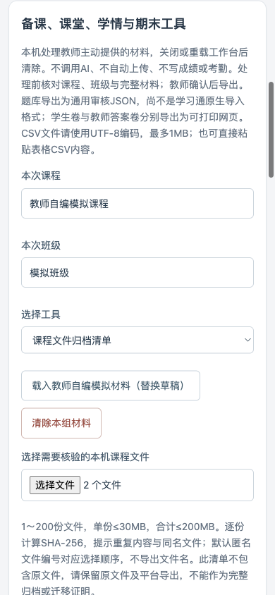
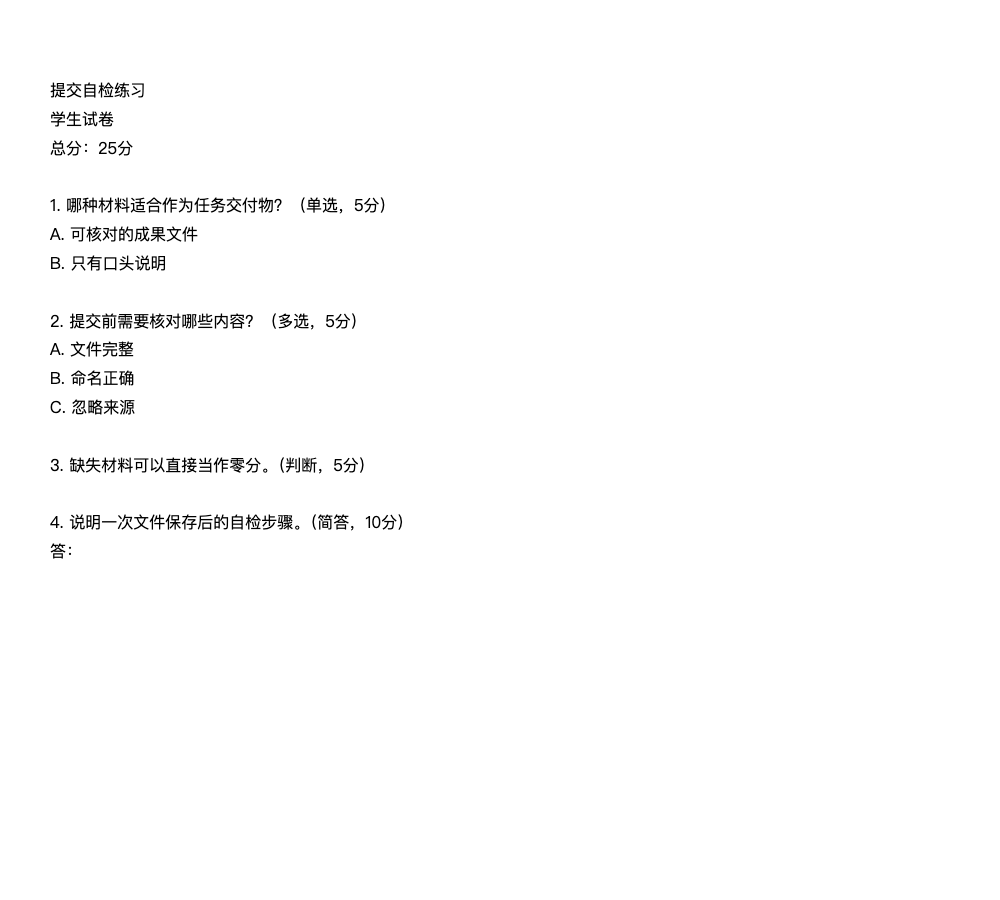

# 学习通教学运营助手 v0.41.0

本轮扩展教师备课、课堂、学情与期末辅助，保留批改、考勤、表格和改期功能。新增工具在**插件弹窗 → 打开审核工作台 → 课程管理 → 备课、课堂、学情与期末工具**。材料只保留在当前工作台，关闭/重载后重新导入。

## 安装与更新

1. 解压“浏览器扩展_脱敏发布包_v0.41.0.zip”，保留整个目录，不要只复制某个脚本。
2. Chrome打开“扩展程序 → 管理扩展程序”，Edge打开“扩展 → 管理扩展”，启用开发者模式。
3. 首次安装选择“加载已解压的扩展程序”，指向解压后含manifest.json的目录。更新时优先替换原扩展目录文件并点击该扩展的重新加载；若加载新目录，请停用旧版本，避免双版本操作同一课程。
4. 确认版本0.41.0，刷新已打开的学习通页面，再打开工作台重新识别范围。扩展重载不保留旧批次的可信状态，必须重新采集；先核对已有平台结果再决定后续提交。

当前提供手动安装包；没有商店发布或无确认的一键安装。Codex本机连接工具仍沿用v0.40.0，不需要另换连接协议。六个新增本机工具不依赖AI、Codex或平台登录；真正平台批改仍需登录、确认范围、评分卡、材料发送授权及逐份审核。

## 六个工具怎么用

所有工具先填写本次课程与班级。选择工具后导入UTF-8 CSV或粘贴CSV内容，核对材料，点击“处理本次材料并生成审核结果”，展开结果，再勾选教师确认后导出。源材料、规则、工具或范围变化会撤销旧确认。需要试用时点击“载入教师自编模拟材料”，示例阈值不是学校政策。

| 工具 | 输入与处理 | 输出及边界 |
|---|---|---|
| 题库审核 | CSV表头“题型,题干,A,B,C,D,答案,解析,分值,知识点”；单选、多选、判断、简答。检查重复题干、答案、选项与分值 | 通用审核JSON；不是学习通原生导入模板，不上传 |
| 按题型组卷 | 有效题库、试卷名称、抽取种子，结构表头“题型,题数,每题分值”。题库不足即停止 | 学生试卷与教师答案卷分别导出可打印HTML；学生卷不含答案/解析 |
| 课堂活动准备 | 讨论、投票问卷、抢答、选人、分组、签到、直播的主题、目标、分钟数、操作要求；分组/选人另填人数与种子 | 活动审核稿、均衡匿名分组或不重复匿名选人；教师将S001起编号与座位对应，不发布或写考勤 |
| 学情快照分析 | 表头“学号,章节完成率,作业完成率,测验成绩,课程访问次数”；完整名单人数与教师阈值。百分率/测验须0～100 | 本机用CSV行号对照异常；缺失保留未获取，均值仅用已获取记录；导出仅汇总，不自动预警 |
| 权重试算与对照 | 规则“项目,权重,满分”；成绩“学号,规则中的全部项目,原总评”；完整人数。权重合计100% | 按得分÷满分×权重试算；缺项不生成总评，原总评保留。只导出脱敏汇总，不回填平台 |
| 文件归档清单 | 主动选择1～200份本机文件，单份≤30MB、合计≤200MB | SHA-256、字节数、重复/同名提示；匿名F编号对应选择顺序。清单不含原文件，不代表完整平台归档/迁移 |

CSV支持带引号的逗号、换行与双引号。文件限1MB；编码错误明确拒绝，请在Excel另存为“CSV UTF-8”。超限材料不截断。学号只校验缺失/重复，不显示于结果或汇总导出。请勿在题目/活动字段粘贴学生身份、作答或凭据；教师答案卷需妥善保管。

## DOCX图片读取变化

新增正文中内嵌PNG/JPEG/WebP原图读取，文字中“内嵌图片N”与原图顺序对应。ZIP目录、重复文件项、解压大小及CRC校验不通过时拒绝读取；图片必须在浏览器完整解码。图像能力未通过测试时不以纯文字替代图文评分。图片限20张、图像材料总量限18MB，超限不截断。

这不是Word页面渲染。浮动/裁剪图片、图表、形状、文本框、页眉页脚引用、替代内容、修订删除等未支持内容转人工或建议转PDF完整读取。原有独立回读和提交前原文件变化核验保留。

## 已取得与尚缺证据

333项自动化测试、原有构建和脱敏发布校验通过。六个工具已在本地页面和实际已安装MV3扩展中使用教师模拟材料完成交互/下载检查；已检查390像素窄屏、注入内容、缺项、错误分值、资料变化、清除与重载。含图DOCX在实际扩展中以教师模拟文件完成解码；不代表真实学生图文AI评分完成。

真实学生材料AI发送、成绩提交本轮均为0。当前作业的学期确认未收到，v0.41.0真实学生附件与待批全量复扫未执行，当前待批状态仍标为未重新获取；v0.40.1的12待批是历史证据，不能代替本轮状态。真实提交、章节测试、Windows Chrome/Edge、其他Mac浏览器与两校教师试用待验收。

## 界面证据（教师模拟材料）

本页及场景矩阵列出的未适配入口，不是已发布功能；完整覆盖需继续开发并取得对应现场证据。

【知识库对齐核验】

- 引用依据：[[工作流-学习通作业批改.md]]、[[工作流-学习通章节测试批阅.md]]、[[自动沉淀规则.md]]、产品需求文档PRD V1.14及[超星教师使用帮助](https://special.chaoxing.com/special/screen/200069142)。
- 锁定口径：教师确认真实范围与标准；最小写入、保护已有成绩、独立回读；未获取不能当作无待批；学生材料仅会话保留；本机工具不等于平台适配或跨校验收。
- 变动警示：按本轮继续开发要求扩展到教师完整教学周期；新本机工具、图像读取和进度清单不代表“所有学习通场景”已完成。学生端与教务管理端未纳入当前默认范围。
